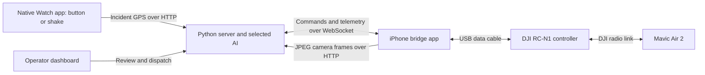

# Guardian Angel — AI-assisted drone observation

**Dashboard and review update:** key aircraft stats are now at the top of the dashboard; repeated iPhone video-byte logging is removed. See [review fixes, validation and teammate handoff](docs/REVIEW_FIXES_2026-09-20.md).

**Telemetry update:** iPhone observations now report at about 5 Hz; altitude and heading display without a GPS lock. Pull, restart the server and rebuild the iPhone app. See [the fix, protocol notes and bench check](docs/TELEMETRY_FIX.md).

Hackathon prototype for Claude Code Build Day, Miami, September 20, 2026. A Watch/phone incident trigger supplies a location, a Python command center plans a supervised search, and a locally installed **iPhone app** connects that server to a **DJI Mavic Air 2**.

**The current implementation uses iPhone + DJI Mobile SDK V4 iOS. Android is no longer part of the build plan.** We use DJI's app SDK; aircraft firmware is not modified.

**Status:** the native Watch app **compiles and links in Xcode CI**, its Swift core tests pass, and all 74 server tests pass. See [Watch validation](watch-app/VALIDATION.md). Signed installation and real GPS/motion/network tests on the team's SE remain. The iPhone bridge compiles and links with its pinned DJI libraries in macOS CI, and its telemetry/navigation tests pass. Lorenzo reported successful telemetry, gimbal control, live video and a mock mission on real hardware. The new telemetry fix still needs the [hardware bench check](docs/TELEMETRY_FIX.md).

## How the pieces connect



The server interprets images and chooses small actions. The iPhone validates those actions and runs a deterministic local flight-control loop through DJI's SDK. The pilot takes off manually and enables flight control locally on the iPhone before server commands can move the aircraft. Reconnecting never automatically re-arms it.

The native **Watch app** now provides Send Help and a deliberate shake gesture, a five-second cancel countdown, location capture, receipts/retries and default-on Test mode. Shake runs only while the app is active; it is not Apple's built-in fall detection. See [Watch setup and first test](docs/WATCH_SETUP.md). A visual "found" result is a candidate for human review. With several people in frame the AI lists every person and must pick one clearly preferred prone or sitting candidate reported as not moving (the server checks the reported posture/motion, both confidence scores and the score margin; these are AI reports, not independently verified facts, see [PROTOCOL.md](docs/PROTOCOL.md#subject-disambiguation-multiple-people-in-frame)); the dashboard draws the boxes and shows an estimated subject distance from the reported point (bbox projected to the ground — an estimate, while `found.lat/lng` remain the aircraft's location).

## Start here

- **Watch SE (2nd generation, watchOS 26.5):** [docs/WATCH_SETUP.md](docs/WATCH_SETUP.md).
- **Mac/iPhone setup and staged tests:** [iphone-bridge/README.md](iphone-bridge/README.md).
- **ChatGPT / Claude subscription or API setup:** [docs/AI_PROVIDERS.md](docs/AI_PROVIDERS.md).
- **Teammate agent context and next tasks:** [docs/AGENT_HANDOFF.md](docs/AGENT_HANDOFF.md).
- **Wire protocol and command semantics:** [docs/PROTOCOL.md](docs/PROTOCOL.md).
- **Review and validation evidence:** [review](iphone-bridge/REVIEW.md), [validation](iphone-bridge/VALIDATION.md).

## Devices and responsibilities

| Device / owner | Responsibility |
|---|---|
| Teammate's Mac | Xcode, CocoaPods, DJI iOS app key, signing, installation and device logs |
| iPhone with the pilot | Bridge app, USB connection to RC-N1, camera preview, local arm and STOP AI |
| RC-N1 + Mavic Air 2 | Aircraft connection, manual takeoff, pilot takeover and DJI RTH |
| Windows laptop or Mac server | Python server, detector, selected AI provider and operator dashboard |
| Apple Watch SE (2nd generation) | Native Watch app sends button/shake help alerts and wearer GPS to the server |
| Lorenzo / server side | Planner, detector, dashboard and incident flow |
| TJ / iPhone side | Native bridge and coordinated protocol/integration changes |

Development can happen remotely, but **the controller-connected iPhone must physically be beside the drone**. Your teammate's Mac and Watch cannot substitute for that phone. Keep the bridge app in the foreground; use a second device for the incident trigger/dashboard if needed.

No App Store deployment is needed. Your teammate builds and installs onto a physical iPhone using Xcode signing. See the bridge guide for Personal Team limitations and exact setup. Pins: DJI SDK **4.16.2**, DJIWidget **1.6.8**, FlySafe resource **01.00.01.18**, deployment target **iOS 15+**. Compatibility with the actual Xcode/iOS/firmware still needs to be demonstrated.

## Run the Python command center

From the repository root, on Windows PowerShell:

```powershell
cd server
python -m venv .venv
.\.venv\Scripts\Activate.ps1
python -m pip install -r requirements.txt
# First install the official Codex CLI and run codex login with ChatGPT.
$env:AI_PROVIDER = 'codex'
$env:AI_MODEL = 'gpt-5.6-luna'
python ai_smoke_test.py --search-check
$env:AUTO_DISPATCH = '0'
python -m uvicorn app:app --host 0.0.0.0 --port 8000
```

On macOS:

```bash
cd server
python3 -m venv .venv
source .venv/bin/activate
python -m pip install -r requirements.txt
# First install the official Codex CLI and run codex login with ChatGPT.
export AI_PROVIDER=codex
export AI_MODEL=gpt-5.6-luna
python ai_smoke_test.py --search-check
export AUTO_DISPATCH=0
python -m uvicorn app:app --host 0.0.0.0 --port 8000
```

The dashboard offers **ChatGPT subscription (Codex CLI), Claude subscription (Claude Code CLI), OpenAI API and Anthropic API**. Sign in on the server computer for subscription use; keys are needed only for API mode. Choose a provider/model while idle and click Apply; reset before switching. The setting lasts until server restart. See [AI setup and test instructions](docs/AI_PROVIDERS.md) for each option, model selection and troubleshooting. There is no automatic fallback to API billing. Keep API keys out of Git. Open the dashboard at `http://localhost:8000`; on the iPhone enter `http://YOUR-LAPTOP-IP:8000`.

Current `server/app.py` already includes the iPhone integration: command expiry, fresh-frame/telemetry checks, disconnect cancellation, reset/stop behavior, and RTH completion timeout. **Do not reapply `iphone-bridge/server-support/patch_server.py` to current main.** It is retained as a reviewed migration for the original scaffold only.

Use a private LAN/hotspot or an authenticated private VPN. The command center has no authentication; do not expose port 8000 through a public tunnel. For remote collaboration the server can also run beside the pilot. HTTP and WebSocket connectivity must work in both directions over the chosen network.

## Local tests and demo sequence

Run `python -m unittest discover -s . -p "test_*.py" -v` from `server/` for provider, mission lifecycle and navigation checks. The ChatGPT subscription path has passed a real synthetic-image test and dashboard incident planning; Claude subscription and both API paths need live checks with your accounts. The current server suite has **37 tests** including Watch acknowledgment, retries, cancellation, location and dispatch checks. Visual search uses `AI_SEARCH_TIMEOUT` (default 30 seconds); frame-age rejection follows that timeout plus 5 seconds, preserving the teammate's current implementation. The CLI default model timed out on the full search check; `gpt-5.6-luna` passed in 7.05 seconds on this laptop. Repeat `--search-check` with your chosen model/network before a mission.


1. **Watch alert-only test:** follow [WATCH_SETUP.md](docs/WATCH_SETUP.md), leave Test mode ON, and check a button alert, cancel, then a shake alert. No drone or AI account is needed for this stage.
2. **Server-only simulation:** run `python sim_drone.py` from `server/` in another terminal. Use the dashboard's development incident and dispatch controls. This checks the existing server workflow without DJI hardware; it does not validate the iPhone.
3. **iPhone mock mode:** build/install the app, then follow the mock-only smoke server instructions in the bridge README. This separate server makes no AI calls. Check camera uploads, command acknowledgments, movement math, STOP and reconnect. It rejects live hardware.
4. **Bench connection:** stop the simulator/smoke server, start the project server, remove propellers, and verify DJI registration, telemetry, decoded camera preview and camera-only gimbal control.
5. **Supervised flight:** record a valid ground GPS anchor in the bridge, take off manually with the RC, position within the demo envelope, enable flight locally, and verify short commands and physical takeover before dispatching an incident mission.

Only one drone connection is allowed. Stop `sim_drone.py` before connecting the iPhone. Restart the project server when switching mock/live or changing launch locations, because the home anchor persists for that server session.

The native Watch uses `/watch/status` and `/watch/alerts`, with deduplication and fresh-location validation described in [the protocol](docs/PROTOCOL.md). For a legacy phone Shortcut only: get current location, then POST JSON to `http://YOUR-SERVER:8000/incident` with `latitude`, `longitude`, `accuracy`, and `source: "watch"`. Confirm location/network access on the device. Keep `AUTO_DISPATCH=0`: the dashboard operator reviews and dispatches the resulting plan. A mock event can be sent with:

```json
{"latitude":25.7618,"longitude":-80.1918,"accuracy":5,"source":"demo"}
```

Those sample coordinates are for the simulator/iPhone mock start at `25.7617,-80.1918`; replace them with the real, nearby demo location for hardware testing.

## Operating envelope

The planner requests roughly 10 m altitude, a 5–10 m demo search radius, and moves of at most 5 m. The server requires target plus search radius within 35 m of home; each move endpoint must remain within 35 m. Use an incident within about 20 m of launch. A small demonstration radius may not cover the full GPS uncertainty and is not an exhaustive rescue search.

The iPhone independently enforces a 40 m ground-anchor radius, 5–30 m relative altitude, 1 m/s horizontal and 0.5 m/s vertical speed, and a 10°/s yaw rate. It requires 30% battery to enable/new navigation and releases control below 25% or when monitored telemetry/link/lifecycle checks fail. These checks do not provide obstacle or terrain avoidance.

**STOP AI requests release of app flight control. It does not stop motors or cancel DJI-managed return-to-home.** RTH uses the aircraft's configured home and altitude, which can extend outside the app's virtual-stick envelope. The pilot checks those settings before launch and uses the RC to cancel RTH or take over. Force-killing/suspending iOS or losing the cable cannot be made safe by an app-only watchdog; aircraft failsafes and pilot supervision remain required.

## Suggested 5–6 hour session

| Time | Milestone |
|---|---|
| First 45–60 min | Mac dependency resolution, Xcode build/install, DJI registration and telemetry |
| Next 60 min | Camera/gimbal bench tests while server teammate checks model access and incident flow |
| Next 60 min | Mock transport checks, command limits, STOP and reconnect; connect the real server |
| Next 60–90 min | Controlled short-command hardware tests if earlier milestones pass |
| Remaining time | Supervised demo, logs, explanation and recording; use clearly labelled simulation if hardware validation remains incomplete |

## Repository layout

```text
watch-app/                      SwiftUI Watch app, Xcode project, signing setup and portable core tests
docs/WATCH_SETUP.md             Watch install, alert-only test, GPS dispatch and troubleshooting
server/                         Python command center, planner, safety, detector, simulator, dashboard
iphone-bridge/ios/              Native app, Xcode project, CocoaPods and Mac setup
iphone-bridge/tools/            Mock-only transport server
iphone-bridge/tests/            Navigation, server-integration and transport checks
iphone-bridge/server-support/   Migration patch for the original scaffold
docs/AI_PROVIDERS.md           Four AI provider options, login, models and inference tests
docs/PROTOCOL.md                Current iPhone/server contract
docs/AGENT_HANDOFF.md           Teammate context and remaining device validation
```

Work directly on `main` as requested by the team; this project is not using pull requests. Coordinate edits before replacing files another teammate is changing.
